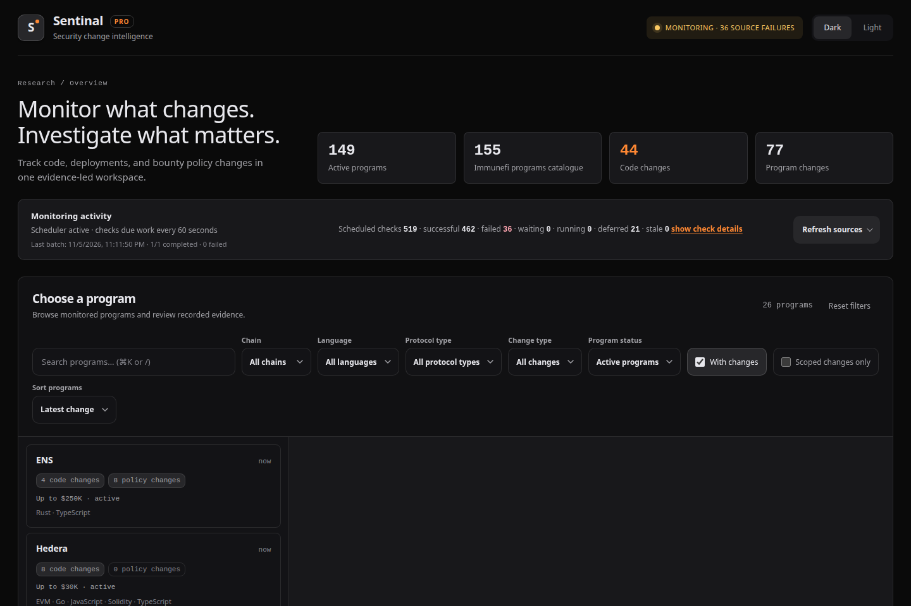
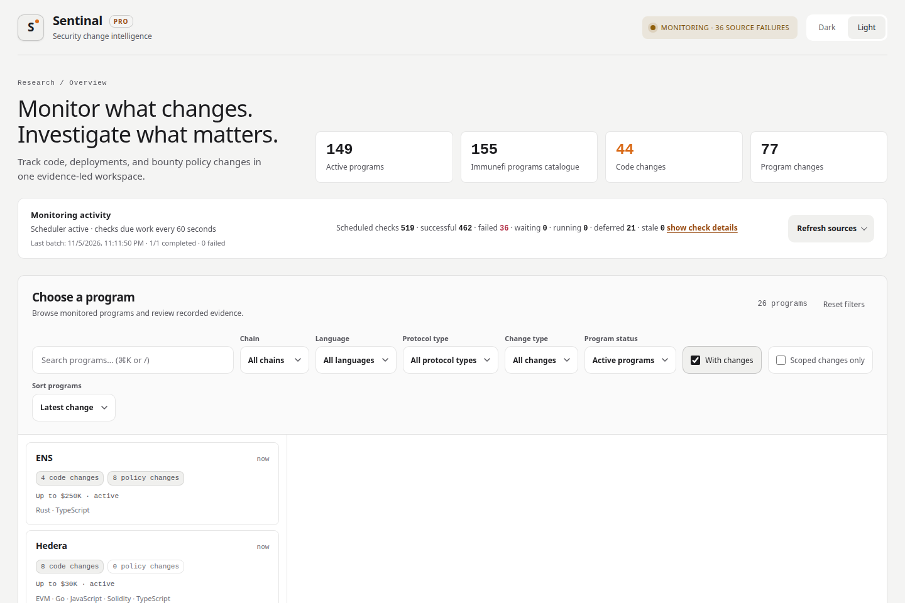

# Sentinal Pro

A local-first monitor for the things you actually hunt: **bug bounty program pages**, **GitHub repos**, and **on-chain contract addresses**.

[](pyproject.toml) [](LICENSE) [](https://github.com/Hsnmughal/Sentinal-Pro/actions/workflows/ci.yml)

<p align="center">
  
</p>

**HEY, HEY, HEY! YOU, YES YOU. LOOK AT ME.**

 You have the whole damn thing. No license server calling home, no Pro tier holding diff downloads hostage, no seat limits.

Now, let's be to each other what these (You Know Who) Aren't to us: **GENEROUS**.

> **Evm:** `0xcc785a11f063c589946e413686a63c313b161e4b`
> **Solana:** `5WnXPkxEnHVk1CdTcSbyA4YJqFSijecU4vFe28ZXydR8`

<p align="center">
  
  <br /><sub>
   If you can't, we still cool, bro. No pressure. Like always, I gotchu. 🤝
  </sub>
</p>

---

Okay, So Coming back, You run it on your own machine. It watches the programs and repos you pick, flags what changed, and hands you the diff. That is the whole product.

One Python process, a localhost dashboard, a scheduler, and SQLite. No external database, no frontend build step, no runtime dependencies. It needs internet to reach the sources you configure; your watchlist, baselines, and exports never leave your disk.

> [!IMPORTANT]
> It gives you recorded changes, not verdicts. Whether a change matters is your call, or your agent's. A quiet dashboard does not mean a program is safe.

## Why I Made Sentinal Pro

Whenever I was scrolling through X, I kept seeing one or two fellow SRs asking for a monitoring tool, and I realised: yeah, monitoring has always been somebody else's tool. There are personal scripts people never share, and there are subscription platforms that do watch for changes, but they come bundled with a dozen other features you did not ask for, a monthly bill, and a dashboard you do not control.

So why not just have your own? That is what this is. A local first monitoring server you run yourself, watching the programs you care about, with nothing to pay and no private access to request. The code, the database, and the dashboard are all on your disk.

The tool is basic, and it does what we all actually need. It watches **GITHUB REPOS, PROGRAM PAGES, AND ONCHAIN CONTRACTS**, flags the changes, and gives you a targeted diff file for each one. Feed that to your agent, or plug the repo in and review it yourself. There is a GUI reviewer on top for the same thing, so you are not living in a terminal.

It also has MCP built in. Describe what you are hunting and let your agent go through the programs you watch, pull the recorded changes, and read the patches, instead of you clicking through every target by hand.

## What It Does

<table>
<tr><td><strong>Program changes:</strong></td><td>Scope, reward, impact, and policy values recorded before and after. A quiet rules edit shows up as an event instead of a rejected submission.</td></tr>
<tr><td><strong>Code changes:</strong></td><td>File-level diffs for the repos you watch, with revisions, file names, and patch text loaded when you expand it. Renames, additions, and deletions get real diff headers.</td></tr>
<tr><td><strong>Diff downloads:</strong></td><td>A ZIP per program or per change with the recorded patches, a manifest, and folder names you can actually read. Missing or partial patches get labelled, never invented.</td></tr>
<tr><td><strong>Agent access:</strong></td><td>An optional local MCP server over stdio, read-only by default, reading the same database your dashboard uses.</td></tr>
</table>

## What It Watches

| Source | Status | How it behaves |
|---|---|---|
| Immunefi program catalogue | Supported | Public discovery of current programs and their repo targets, hourly |
| Program pages | Supported | Scope, reward, impact, and policy snapshots, four-hour checks by default |
| GitHub repositories | Supported | Commit comparisons and release boundaries, 10 minutes / 30 minutes / 3 hours by priority |
| Custom bounty JSON endpoints | Supported | Complete-snapshot polling for self-hosted or third-party program data |
| EVM contracts (manual) | Supported | ERC-1967 implementation slot checks you click yourself, against your own RPC |

Each source is its own adapter: an `adapter.toml` manifest for its data (poller type, intervals, event kinds, URL hosts) and an `adapter.py` for its behaviour. They are discovered from the package folder, and the registry never branches on a platform name, so adding HackerOne, Code4rena, or whatever you want is just a new package under `sentinal/adapters/`. There is a `_template/` there to start from.

You do not touch the monitoring engine, the web API, the dashboard, or your database schema to add one. That is why future platforms can land without forking the core.

## What It Works With

It does not care about your stack. It records whatever a source publishes.

<table>
<tr><td>Smart contracts, any language or VM</td><td>Web and application repos</td></tr>
<tr><td>Structured or free-form scope rules</td><td>Mixed targets across contracts, apps, nodes, or bridges</td></tr>
<tr><td>EVM proxies on the ERC-1967 implementation slot</td><td>Any public Git repo the configured source can reach</td></tr>
</table>

## What You Need

- Python 3.11 or newer, with `pip` and `venv`.
- Git, if you are cloning. An extracted source folder runs without it.
- Node.js is not required to run the app or the published checks.

## Install

Clone the repo, open a terminal in the folder, make a venv, install, init, run. Pick your platform.

### Windows PowerShell

```powershell
py -3 -m venv .venv
.\.venv\Scripts\python.exe -m pip install -e .
.\.venv\Scripts\python.exe -m sentinal init
.\run-local.ps1
```

No `py` launcher? Use `python -m venv .venv` with Python 3.11+ installed. The launcher always uses this project's venv.

### Linux and macOS

```sh
python3 -m venv .venv
.venv/bin/python -m pip install -e .
.venv/bin/python -m sentinal init
sh run-local.sh
```

Open **http://127.0.0.1:8080** and hit **Ctrl+C** in the terminal to stop. Your data stays on disk, and the next run picks up the stored baselines. Want another port? `sentinal run --port 8081`, `.\run-local.ps1 -Port 8081`, or `sh run-local.sh --port 8081`.

`init` creates the config and the database without touching the internet. `run` creates the config too if it is missing. Neither overwrites what you already have.

## Running It

The dashboard gives you a card per program with counts for **Code changes** and **Program changes**, plus filters for chain, language, protocol type, lifecycle, and change type. Expand a code change and the hunks load in place. Expand a program change and you get the recorded before and after.

```console
sentinal init                          # config.toml and the database
sentinal run                           # dashboard + automatic monitoring
sentinal poll --source github          # force one check, same limits apply
sentinal events --limit 50             # dump recorded changes as JSON
sentinal --config ./local/config.toml run
```

The browser checks for stored updates every 15 seconds and refreshes the program you have open, keeping your expanded diffs and scroll position. That is not polling. Polling is separate: catalogue discovery hourly, GitHub by repo priority, program pages every four hours by default.

Light mode, same dashboard, same evidence:

<p align="center">
  
</p>

## First Run and Credentials

The default config starts with the public Immunefi catalogue and nothing else. No placeholder repos, no fake bounty endpoints, no proxy addresses.

The first successful check only sets a baseline. **Changes show up after that**, so do not panic when the feed looks empty on day one.

A GitHub token is optional for public repos but gets you a bigger quota. Copy `.env.example` to `.env` next to `config.toml`, set your own `GITHUB_TOKEN`, restart. RPC URLs are only needed for the manual on-chain button, and you do not need an Etherscan key.

Want to add a specific repo or change intervals? See [Configuration](docs/configuration.md).

## MCP (Let Your Agent Do the Clicking)

After `sentinal init`, point an MCP host at the same local database:

```console
sentinal --config /absolute/path/to/config.toml mcp
```

Read-only by default, no background polling, no web server. Keep `sentinal run` going separately if you want fresh data. It speaks the MCP 2025-11-25 stdio tool interface, so it is local, not some hosted service, and it returns what was recorded rather than an AI verdict.

Seven tools: `list_programs`, `get_program`, `list_changes`, `get_change`, `get_file_patch`, `get_monitor_status`, and `queue_check` if you start it with `--enable-queue`. Everything is page-bounded, and long patches come back in small slices on request.

See [MCP integration](docs/mcp.md) for the tool contracts, paging, and the trust boundary.

## Diff Downloads

Every ZIP has the real recorded patches, a short README, and a `manifest.json` with the repo, revisions, observation time, source URL, and anything missing or partial:

```text
changes/
  owner--repository/
    2026-10-08_21-30-00Z_abc1234567...def1234567/
      0001-Example.sol.diff
```

Binary files and missing text patches are listed, not faked. Truncated ones end in `.partial.diff`, old migrated patches are marked unverified, and incomplete comparisons are labelled separately. Every observation gets its own folder, so this is not one synthesized net diff. And no, it never clones, installs, or runs the repos you watch.

## Your Data Stays Yours

Your watchlist, baselines, patches, and exports are yours. `config.toml`, `.env`, SQLite databases and backups, generated `platforms/` views, and local tooling settings are all out of version control.

> [!CAUTION]
> Keep the default `127.0.0.1` binding. There is no multi-user auth here, it is built for one person on one machine.
>
> Back up `sentinal.db`, `config.toml`, and `.env` with the server stopped before you upgrade.
>
> Never paste local databases, tokens, private repo names, or recorded patch text into an issue or PR.

It fetches remote metadata and patches. Read a patch before you apply it, and only install adapters you trust, because adapters are local Python code.

---

## Contributing · Security · License · Contact

Setup and the release checks are in [CONTRIBUTING.md](CONTRIBUTING.md). Follow the [Code of Conduct](CODE_OF_CONDUCT.md).

```console
python -m pip install -e ".[dev]"
python scripts/check_release.py
```

Do not post vulnerabilities or private monitoring data in a public issue. Use [SECURITY.md](SECURITY.md) for private reporting.

Sentinal Pro is **source-available** under the [PolyForm Noncommercial License 1.0.0](LICENSE). Use it, fork it, contribute to it, run it for research and hobby work. You cannot sell it or ship it commercially. It is not OSI-approved open source, and commercial licensing is available on request.

[](https://hsnmughal.surge.sh/) [](https://x.com/hsnmughal_) 
